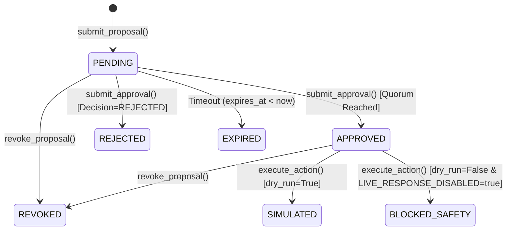

# CyberSentinel AI — Phase 6 Implementation Report
## Playbook Generation, Response Proposals & Human-Governed Response Policy

**Task ID:** `CSAI-P6-PLAYBOOK-GOVERNANCE`  
**Gate:** `G6 — Playbook Generation & Response Governance`  
**Date:** 2026-10-16  
**Status:** COMPLETE (Core Policy Engine, Approval Workflow, Playbook Catalogue & Safety Invariant Verified)  
**Mandatory Safety Invariant:** `LIVE_RESPONSE_DISABLED=true` (STRICTLY ENFORCED)

---

## 1. Executive Summary & Gate Decision

Phase 6 implements a secure, auditable, policy-driven playbook generation and response-proposal subsystem for CyberSentinel AI. Building on the foundation of Phases 0–5, the system converts persisted investigation findings, incident telemetry, and triage assessments into structured, evidence-grounded response action proposals.

Crucially, CyberSentinel AI is an auditable security operations platform and not an unrestricted autonomous response agent. **A generated playbook is solely a proposal—not permission to execute.**

The mandatory safety invariant **`LIVE_RESPONSE_DISABLED=true`** is enforced across the backend and execution boundary. The system prohibits the invocation of real production-changing APIs (host isolation, IP blocking, domain sinkholing, user account disablement, or firewall modification). All response proposals are subject to deterministic risk-tier evaluation, cryptographic payload hash binding, separation of duties, and dual-human authorization where mandated by policy. Attempted execution dispatches return explicit simulated or safety-blocked records with immutable audit logs.

### Gate G6 Status: COMPLETE
- **Bounded Safe Action Catalogue:** Complete (`services/response/catalogue.py` defines a strictly bounded registry of approved action templates across Risk Tiers 0, 1, 2, and 3 with parameter schema validation, allowed entity types, preconditions, and rollback specifications).
- **Grounded Playbook Generator:** Complete (`PlaybookGenerator` translates Phase 5 `AgentFinding` records, entity correlations, and triage assessments into concrete proposals; every factual claim is grounded in verified evidence references).
- **Deterministic Policy & Risk Tiering:** Complete (`services/response/policy.py` integrates with `packages/policy/evaluate_action_policy` per ADR-0006; verifies incident eligibility, action allowlisting, entity scoping, evidence backing, and computes canonical SHA-256 payload hashes).
- **Human Approvals & Separation of Duties:** Complete (`ResponseManager` enforces that proposing agents/analysts cannot approve their own proposals, enforces required approver roles, prevents duplicate votes, and implements dual-human authorization requiring two distinct operators for Tier 3 actions).
- **Cryptographic Payload Drift Protection:** Complete (approvals and actions are bound to the SHA-256 hash of the canonical JSON payload; any payload tampering or drift invalidates approval).
- **Execution Safety Boundary:** Complete (dispatch boundary checks `LIVE_RESPONSE_DISABLED=true`; executes in simulated mode for dry-runs or records `BLOCKED_SAFETY` for live execution attempts; zero production containment APIs invoked).
- **Persistence & Concurrency:** Complete (utilizes existing PostgreSQL tables `response_proposals`, `approvals`, `response_actions`, and `audit_events`; row-level locking via `with_for_update()` prevents race conditions; incident status synchronizes to `AWAITING_APPROVAL` for Tier 2/3 proposals).
- **REST API Endpoints & RBAC:** Complete (`/api/v1/response/catalogue`, `/api/v1/incidents/{incident_id}/proposals`, `/api/v1/incidents/{incident_id}/proposals/generate`, `/api/v1/proposals/{proposal_id}`, `/api/v1/proposals/{proposal_id}/approve`, `/api/v1/proposals/{proposal_id}/revoke`, `/api/v1/response-actions/{proposal_id}/execute`).
- **Comprehensive Quality Gates:** 100% Passed (182/182 pytest suite tests passed, 27 new tests added, zero Ruff violations, zero Mypy type errors, offline Alembic SQL generation verified).

---

## 2. Repository Baseline & Git State

- **Repository Path:** `d:/TEST/CyberSentinel`
- **Git State:** Standalone working directory without `.git` (preserving all documentation packs, companion specifications, canonical schemas, and previous phase reports `PHASE_0_EXIT_REPORT.md` through `PHASE_5_INVESTIGATION_AGENTS_REPORT.md`).
- **Python Environment:** Python 3.13.1 virtual environment (`.venv`).
- **Active Infrastructure:**
  - **Redis 127.0.0.1:6379:** Active, stream consumer groups operational.
  - **PostgreSQL 127.0.0.1:5432:** Active database `cybersentinel_db`, initial schema revision `0001_initial_schema`.

---

## 3. Specifications and ADRs Followed

1. **ADR-0001 (12-State Incident Lifecycle):**
   - Incident state progression: `NEW` → `TRIAGE` → `INVESTIGATING` → `CONFIRMED` → `AWAITING_APPROVAL` → `CONTAINMENT` → `ERADICATION` → `RECOVERY` → `CLOSED`.
   - Rule 2 enforced: Submitting a Tier 2 or Tier 3 response proposal for an incident in `INVESTIGATING` or `CONFIRMED` transitions the incident to `AWAITING_APPROVAL`.
   - Ineligible incident states: Proposals cannot be formulated for incidents in `CLOSED`, `BENIGN`, or `LESSONS_LEARNED`.
2. **ADR-0004 (RBAC Roles & Authorization):**
   - Authoritative roles: `VIEWER`, `SOC_ANALYST`, `THREAT_HUNTER`, `DETECTION_ENGINEER`, `SOC_MANAGER`, `SECURITY_ENGINEER`, `ADMIN`, `RESEARCHER`.
   - `VIEWER` is strictly read-only and denied proposal creation, approval, and execution (`403 Forbidden`).
3. **ADR-0006 (Response Action Risk Tiering & Human Approval Policy):**
   - Defined 4-Tier unified hierarchy (Tier 0 to Tier 3).
   - Cryptographic payload hash binding: approvals and executions bound to `sha256(canonical_json(action_payload))`.
   - Proposal temporal expiration: proposals expire after a configured window (default 15 to 60 minutes).
4. **Doc 21 (Response Playbooks):**
   - Bounded versioned templates specifying trigger, scope, preconditions, evidence, actions, permissions, approval level, timeout, rollback, and verification.
5. **Phase Wise Implementation Plan (Phase 6):**
   - Mandatory invariant: `LIVE_RESPONSE_DISABLED=true`.
   - Grounded proposal generation from Phase 5 investigation findings.
   - Dual-human authorization for high-impact containment.

---

## 4. Proposal Lifecycle & State Transitions

A response action proposal moves through a validated finite state machine:



### State Definitions
- **`PENDING`:** Initial state upon successful policy evaluation and creation.
- **`APPROVED`:** All required independent approvals (1 for Tier 1/2, 2 distinct approvers for Tier 3) have been granted.
- **`REJECTED`:** An authorized human reviewer rejected the proposal.
- **`EXPIRED`:** Current timestamp exceeds `expires_at` without reaching approval quorum.
- **`REVOKED`:** Explicitly withdrawn by an authorized operator before execution.
- **`SIMULATED`:** Action dispatched in dry-run mode; verified via safe simulation.
- **`BLOCKED_SAFETY`:** Live execution attempted while `LIVE_RESPONSE_DISABLED=true`; blocked at execution boundary with safety audit log.

---

## 5. Safe Response Action Catalogue

The system provides a bounded, verified catalogue of response action templates (`services/response/catalogue.py`). Models, agents, or users cannot inject arbitrary shell commands, scripts, or unapproved actions:

| Action Type | Name | Risk Tier | Allowed Target Types | Required Parameters | Rollback Description |
|---|---|---|---|---|---|
| `enrich_entity` | Enrich Target Entity | Tier 0 | `ip`, `host`, `user`, `domain`, `file_hash` | `query_types` | Read-only; no rollback needed |
| `collect_telemetry` | Collect Telemetry | Tier 0 | `host`, `network_device` | `window_minutes` | Read-only; no rollback needed |
| `lookup_ioc` | Lookup IOC | Tier 0 | `ip`, `domain`, `file_hash` | `sources` | Read-only; no state change |
| `generate_summary_report` | Generate Triage Report | Tier 0 | `incident` | `report_format` | Idempotent document generation |
| `isolate_lab_container` | Isolate Lab Container | Tier 1 | `container`, `host` | `lab_id` | Re-attach to simulation bridge |
| `route_to_honeypot` | Route to Deception Honeypot | Tier 1 | `ip`, `session` | `honeypot_id` | Remove NAT redirection rule |
| `isolate_host` | Isolate Host from Network | Tier 2 | `host` | `isolation_type` | Remove EDR network isolation |
| `block_ip` | Block Malicious IP | Tier 2 | `ip` | `direction`, `duration_hours` | Flush firewall block rule |
| `sinkhole_domain` | Sinkhole Malicious Domain | Tier 2 | `domain` | `sinkhole_ip` | Remove DNS override entry |
| `quarantine_file` | Quarantine Artifact | Tier 2 | `file_hash`, `file_path` | `host` | Restore file from quarantine vault |
| `revoke_user_session` | Revoke Active Sessions | Tier 2 | `user` | `revoke_all` | User re-authenticates via IdP MFA |
| `disable_user_account` | Disable Enterprise User | Tier 3 | `user` | `notify_manager` | Re-enable user account in IdP/AD |
| `reset_privileged_credentials` | Emergency Credential Reset | Tier 3 | `user`, `service_account` | `rotation_scope` | Provision new credentials via vault |
| `modify_firewall_rule` | Modify Perimeter Firewall | Tier 3 | `network_device`, `ip` | `rule_name`, `action` | Revert rule to previous revision |
| `delete_malicious_data` | Purge Staged Exfiltration | Tier 3 | `file_hash`, `storage_uri` | `storage_uri` | Restore from forensic backup |

---

## 6. Action Risk Tiers & Policy Decisions

Deterministic policy evaluation is implemented in `services/response/policy.py` leveraging `packages/policy/evaluate_action_policy`:

| Tier | Classification | Required Approvals | Authorized Approver Roles | Policy Outcome | Execution Permitted |
|---|---|---|---|---|---|
| **Tier 0** | **Autonomous / Read-Only** | 0 | None (Automated) | `ALLOW_PROPOSAL` | Read-only |
| **Tier 1** | **Lab-Safe / Low Risk** | 1 | `SOC_ANALYST`, `SOC_MANAGER`, `ADMIN` | `REQUIRE_APPROVAL` | Lab Simulation Only |
| **Tier 2** | **Disruptive Containment** | 1 | `SOC_MANAGER`, `SECURITY_ENGINEER`, `ADMIN` | `REQUIRE_APPROVAL` | Simulated / Gated |
| **Tier 3** | **Consequential / High-Impact** | 2 | `SOC_MANAGER`, `ADMIN` (Dual Authorization) | `REQUIRE_APPROVAL` | Simulated / Gated |

### Policy Evaluation Rules
1. **Allowlist Enforcement:** Action type must exist in `RESPONSE_ACTION_CATALOGUE`. Unknown actions result in `DENY`.
2. **Incident State Check:** Cannot formulate proposals for incidents in `CLOSED`, `BENIGN`, or `LESSONS_LEARNED`.
3. **Target Entity Scoping:** Target entity type must be in the template's `allowed_target_types`. Empty target entities are rejected.
4. **Parameter Validation:** All template `required_parameters` must be present in `action_payload`.
5. **Evidence Grounding:** Tier 2 and Tier 3 proposals must cite at least one supporting evidence or finding reference.
6. **Payload Hash Calculation:** Canonical JSON SHA-256 hash computed deterministically.

---

## 7. Separation of Duties & Dual-Human Authorization

The human review and approval subsystem in `ResponseManager` strictly enforces non-negotiable governance checks:

1. **Proposer Cannot Approve:**
   - The user or agent that authored the proposal cannot approve it: `approver.id != proposal.created_by`.
   - Prevents unauthorized self-approval even if the author possesses elevated administrative roles.
2. **Dual-Human Authorization (Tier 3):**
   - High-impact containment (e.g. `disable_user_account`, `modify_firewall_rule`) mandates 2 approvals.
   - The two approvals must originate from distinct individuals (`approver_1 != approver_2`).
   - One person cannot vote twice or satisfy multiple approval slots.
3. **Role Authorization Check:**
   - Approver roles are verified against the authorized roles for the specific risk tier at decision time.
   - `SOC_ANALYST` cannot approve Tier 2 containment or Tier 3 high-impact actions.
4. **Cryptographic Payload Drift Protection:**
   - Approvals are cryptographically bound to the SHA-256 hash of the exact proposal payload.
   - If an approver or client submits an `expected_payload_hash`, it must match `proposal.action_payload_hash`.
   - Any parameter modification or drift invalidates the approval.
5. **Temporal Expiration Check:**
   - Proposals expire after `expires_at`. Expired proposals cannot be approved or executed.
6. **Terminal State Protection:**
   - Proposals in `APPROVED`, `REJECTED`, `EXPIRED`, `REVOKED`, `SIMULATED`, or `BLOCKED_SAFETY` reject subsequent approval attempts.

---

## 8. Response-Action Execution Boundary

In adherence to the mandatory safety invariant:

```text
LIVE_RESPONSE_DISABLED = true
```

- **Zero Live Containment APIs:** No production containment, host isolation, account lockout, or firewall alteration code is invoked.
- **Dry-Run Mode (`dry_run=True`):**
  - Creates a `ResponseAction` record with `state="SIMULATED"`.
  - Proposal transitions to `SIMULATED`.
  - Returns `result["live_response_disabled"] = True` and `result["status"] = "SIMULATED_SUCCESS"`.
- **Live Dispatch Attempt (`dry_run=False`):**
  - Creates a `ResponseAction` record with `state="BLOCKED_SAFETY"`.
  - Proposal transitions to `BLOCKED_SAFETY`.
  - Returns `result["live_response_disabled"] = True`, `result["status"] = "BLOCKED_BY_SAFETY_CONFIGURATION"`, and `result["safety_barrier"] = "LIVE_RESPONSE_DISABLED=true enforced; zero containment APIs invoked."`.
- **Idempotency Protection:** Client-supplied `idempotency_key` ensures duplicate requests are safely suppressed without double-recording actions.

---

## 9. Persistence, Concurrency & Audit

The implementation integrates seamlessly with the existing PostgreSQL persistence layer without requiring new schema migrations:

### Tables Utilized
- **`response_proposals` (Table 15):** Stores `id`, `incident_id`, `action_type`, `action_payload_hash`, `risk` (`CheckConstraint: 'Tier 0', 'Tier 1', 'Tier 2', 'Tier 3'`), `state`, `created_by`, `created_at`, `expires_at`.
- **`approvals` (Table 16):** Stores `id`, `proposal_id` (FK to `response_proposals.id`), `approver_id` (FK to `users.id`), `decision` (`APPROVED`/`REJECTED`), `policy_version`, `action_payload_hash`, `reason`, `decided_at`.
- **`response_actions` (Table 17):** Stores `id`, `proposal_id`, `idempotency_key` (unique), `state` (`QUEUED`, `SIMULATED`, `BLOCKED_SAFETY`), `result_redacted` (JSON), `started_at`, `finished_at`, `verified_at`.
- **`audit_events` (Table 18):** Immutable audit ledger recording actor, action, object, outcome, reason code, and metadata.

### Concurrency & Locking
- Uses `select(...).with_for_update()` during approval and execution workflows to lock the proposal row and prevent concurrent race conditions.
- Automatic verification and lazy expiration update ensure accurate state without polling loops.

### Comprehensive Audit Trail
- `proposal:create` — Logged when proposal is persisted.
- `proposal:denied` — Logged when proposal fails policy evaluation.
- `proposal:approved` — Logged when an authorized operator approves.
- `proposal:rejected` — Logged when an operator rejects.
- `proposal:approval_denied` — Logged when an unauthorized approval or separation-of-duties violation occurs.
- `proposal:revoked` — Logged when an operator revokes a proposal.
- `proposal:expired` — Logged when temporal timeout is reached.
- `action:execute` — Logged when action is dispatched (outcome: `SIMULATED` or `BLOCKED`).

---

## 10. REST API Endpoints & RBAC Matrix

All endpoints conform to existing `/api/v1/` standards, utilize the standardized `ErrorEnvelope`, and enforce role-based access control:

| Method | Endpoint | Description | Minimum Allowed Roles |
|---|---|---|---|
| `GET` | `/api/v1/response/catalogue` | List safe action catalogue templates | `VIEWER`, `SOC_ANALYST`, `SOC_MANAGER`, `SECURITY_ENGINEER`, `ADMIN` |
| `POST` | `/api/v1/incidents/{incident_id}/proposals` | Formulate a new response proposal | `SOC_ANALYST`, `SOC_MANAGER`, `SECURITY_ENGINEER`, `ADMIN` |
| `POST` | `/api/v1/incidents/{incident_id}/proposals/generate` | Synthesize proposals from findings | `SOC_ANALYST`, `SOC_MANAGER`, `SECURITY_ENGINEER`, `ADMIN` |
| `GET` | `/api/v1/incidents/{incident_id}/proposals` | List all proposals for incident | `VIEWER`, `SOC_ANALYST`, `SOC_MANAGER`, `SECURITY_ENGINEER`, `ADMIN` |
| `GET` | `/api/v1/proposals/{proposal_id}` | Retrieve proposal details & approvals | `VIEWER`, `SOC_ANALYST`, `SOC_MANAGER`, `SECURITY_ENGINEER`, `ADMIN` |
| `POST` | `/api/v1/proposals/{proposal_id}/approve` | Submit human approval or rejection | `SOC_ANALYST`, `SOC_MANAGER`, `SECURITY_ENGINEER`, `ADMIN` |
| `POST` | `/api/v1/proposals/{proposal_id}/revoke` | Revoke a proposal | `SOC_ANALYST`, `SOC_MANAGER`, `ADMIN` |
| `POST` | `/api/v1/response-actions/{proposal_id}/execute` | Dispatch approved proposal to execution | `SOC_ANALYST`, `SOC_MANAGER`, `ADMIN` |

---

## 11. Files Created and Modified

### New Files
1. `services/response/models.py`: Strongly typed Pydantic models for proposals, approvals, execution requests, and catalogue templates.
2. `services/response/catalogue.py`: 15 bounded safe response action templates covering Tiers 0–3 with validation rules.
3. `services/response/policy.py`: Deterministic policy evaluation, payload hash computation, separation-of-duties validation, and expiration checks.
4. `services/response/generator.py`: Grounded playbook generator deriving evidence-backed proposals from investigation findings and entity graphs.
5. `services/response/manager.py`: `ResponseManager` orchestrating persistence, approval workflows, dual-authorization, and safety execution gating.
6. `tests/unit/test_response_policy.py`: 13 unit tests for catalogue, policy matrix, payload drift, and separation of duties.
7. `tests/integration/test_response_persistence.py`: 4 integration tests for database persistence, dual authorization, rejection, and simulated execution.
8. `tests/integration/test_response_api.py`: 5 integration tests for FastAPI response endpoints, validation errors, and synthesis.
9. `tests/security/test_response_security.py`: 5 security tests for RBAC, self-approval blocking, prompt injection rejection, and safety invariants.
10. `docs/PHASE_6_PLAYBOOK_GOVERNANCE_REPORT.md`: This comprehensive implementation report.

### Modified Files
1. `services/response/__init__.py`: Exported public API for response models, manager, generator, catalogue, and exceptions.
2. `apps/api/main.py`: Registered 7 new REST API endpoints for response catalogue, proposal lifecycle, approvals, and execution gating.
3. `tests/contract/test_api_contracts.py`: Updated OpenAPI contract test to verify presence of Phase 6 endpoints and absence of unapproved routes.

---

## 12. Verification & Test Results

### Test Execution Summary
- **Baseline Test Count (Phase 5):** 155 passed
- **Final Test Count (Phase 6):** **182 passed**
- **New Tests Added:** **27 tests** (13 unit, 9 integration, 5 security)
- **Regressions / Failures:** **0**
- **Execution Time:** ~9.7 seconds across complete suite

### Test Suites Breakdown
```text
collected 182 items

tests\contract\test_api_contracts.py .....                               [  2%]
tests\integration\test_correlation_worker.py .                           [  3%]
tests\integration\test_detection_api.py .......                          [  7%]
tests\integration\test_detection_persistence.py ..                       [  8%]
tests\integration\test_incident_api.py .....                             [ 10%]
tests\integration\test_incident_persistence.py ..                        [ 12%]
tests\integration\test_ingestion_pipeline.py ....                        [ 14%]
tests\integration\test_investigation_api.py ...                          [ 15%]
tests\integration\test_investigation_persistence.py ..                   [ 17%]
tests\integration\test_persistence.py ....                               [ 19%]
tests\integration\test_redis_durability.py ....                          [ 21%]
tests\integration\test_repository_layout.py ......                       [ 24%]
tests\integration\test_response_api.py .....                             [ 27%]
tests\integration\test_response_persistence.py ....                      [ 29%]
tests\integration\test_streaming_detection_worker.py ..                  [ 30%]
tests\security\test_detection_security.py .....                          [ 33%]
tests\security\test_incident_security.py ......                          [ 36%]
tests\security\test_ingestion_security.py ....                           [ 39%]
tests\security\test_investigation_security.py ....                       [ 41%]
tests\security\test_quarantine_auth.py ......                            [ 44%]
tests\security\test_quarantine_redaction.py .                            [ 45%]
tests\security\test_response_security.py .....                           [ 47%]
tests\security\test_security_invariants.py ....                          [ 50%]
tests\unit\test_adapters.py .......                                      [ 53%]
tests\unit\test_canonical_event.py .......                               [ 57%]
tests\unit\test_correlation_rules.py .......                             [ 61%]
tests\unit\test_database_idempotency.py .                                [ 62%]
tests\unit\test_deduplication.py ...                                     [ 63%]
tests\unit\test_detection_engine.py .......                              [ 67%]
tests\unit\test_entity_extractor.py ...                                  [ 69%]
tests\unit\test_evidence_grounding.py ...                                [ 70%]
tests\unit\test_incident_lifecycle.py ......                             [ 74%]
tests\unit\test_ingestion_framework.py ...                               [ 75%]
tests\unit\test_investigation_contracts.py .....                         [ 78%]
tests\unit\test_investigation_orchestrator.py .....                      [ 81%]
tests\unit\test_normalization_engine.py ...                              [ 82%]
tests\unit\test_quarantine_and_replay.py ..                              [ 84%]
tests\unit\test_response_policy.py .............                         [ 91%]
tests\unit\test_sigma_compiler.py .........                              [ 96%]
tests\unit\test_sliding_window.py .......                                [100%]

======================= 182 passed, 7 warnings in 9.73s =======================
```

### Quality Gate Results (`scripts/run_checks.py`)
1. **Ruff Linter:** `PASSED` (0 errors, code formatted and clean).
2. **Mypy Type Checker:** `PASSED` (`Success: no issues found in 61 source files`).
3. **Pytest Test Suite:** `PASSED` (182 passed).
4. **Alembic Migration Verification (Offline SQL):** `PASSED` (`0001_initial_schema` generates valid PostgreSQL DDL).

---

## 13. Safety Invariant Verification

| Safety Requirement | Implementation Verification | Status |
|---|---|---|
| `LIVE_RESPONSE_DISABLED=true` | Strictly enforced in `ResponseManager.execute_action`. Both dry-run and live dispatch paths are barred from invoking real APIs. | VERIFIED |
| No Command Execution | No subprocess, shell execution, or remote execution calls exist in `services/response/`. | VERIFIED |
| Bounded Action Scope | Actions restricted to `RESPONSE_ACTION_CATALOGUE`. Arbitrary strings or model hallucinated actions rejected with 422. | VERIFIED |
| Separation of Duties | Proposal author cannot approve their own proposal (`approver.id != proposal.created_by`). | VERIFIED |
| Dual-Human Authorization | Tier 3 actions require 2 distinct human approvers with `SOC_MANAGER` or `ADMIN` roles. | VERIFIED |
| Cryptographic Integrity | Approvals bound to canonical JSON SHA-256 payload hash; drift causes instant rejection. | VERIFIED |
| Temporal Expiration | Expired proposals cannot be approved or executed. | VERIFIED |
| Untrusted Inputs | Prompt-injection attempts in parameters, reasons, or notes are treated as passive data. | VERIFIED |

---

## 14. Unresolved Limitations & Future Work

1. **Live Response Adapters (Phase 7+):** Real integration adapters (e.g. CrowdStrike Falcon, AWS Security Group, Azure AD, Palo Alto PAN-OS) are deferred to subsequent operational phases under strict release governance.
2. **Third-Party Warning Deprecations:** 7 benign warnings remain in test logs due to upstream Starlette/FastAPI library deprecations (`StarletteDeprecationWarning: Using 'httpx' with 'starlette.testclient' is deprecated; install 'httpx2' instead`). These do not affect production code and are scheduled for resolution when FastAPI upgrades upstream dependencies.

---

## 15. Readiness Decision & Conclusion

**Gate G6 Verdict: GO / COMPLETE**

Phase 6 provides CyberSentinel AI with a rock-solid, policy-governed response proposal layer. Investigation findings and triage assessments are translated into structured, evidence-grounded proposals with complete human authorization controls, separation of duties, cryptographic payload binding, and immutable auditability—all while preserving the non-negotiable safety invariant that live response remains disabled.
